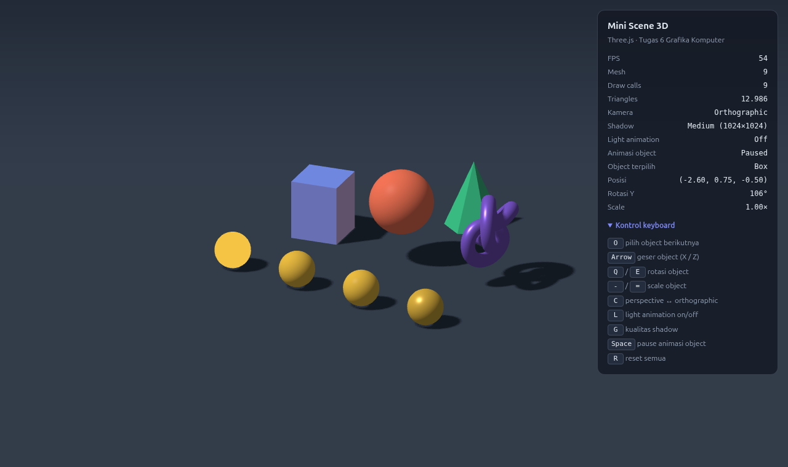
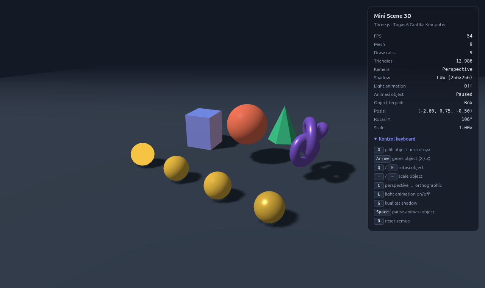
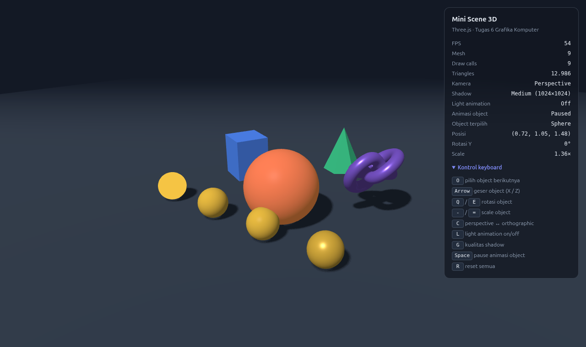
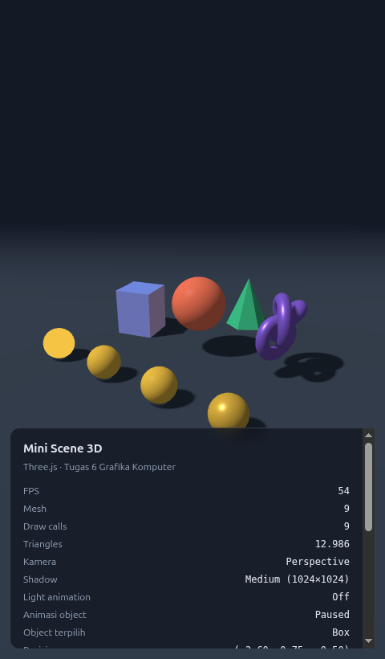

# Tugas 6 — Mini Scene 3D dengan Three.js

Mata kuliah Grafika Komputer (EF234504), Departemen Teknik Informatika ITS.

## Identitas kelompok

**Kelompok:** _(nama/nomor kelompok)_

| Nama | NRP |
| --- | --- |
| Frenaldy Bestabba Hasugian | 5025241156 |
| Himawan Rakha Bhadra | _(NRP menyusul)_ |

## Judul dan deskripsi scene

**Mini Scene 3D — Galeri Bentuk dan Material di Bawah Matahari Bergerak**

Sebuah ground luas berisi box, sphere, torus knot, dan cone, ditambah deretan empat bola
galeri yang memakai material berbeda. Scene diterangi cahaya ambient dan sebuah
DirectionalLight yang mengorbit seperti matahari, sehingga bayangan setiap object bergerak
mengikutinya. Object bisa dipilih lalu digeser, diputar, dan di-scale lewat keyboard, kamera
bisa ditukar ke orthographic, dan kualitas shadow bisa diubah saat runtime. HUD di pojok kanan
menampilkan informasi scene secara langsung.


## Cara menjalankan

Tugas ini bagian dari portal Next.js kelompok, sama seperti Pertemuan 1–5. Dari root repo:

```bash
npm install
npm run dev
```

Lalu buka <http://localhost:3000/pertemuan/pertemuan-6>.

## Struktur berkas

Seluruh isi Pertemuan 6 ada di satu folder, `components/praktikum/pertemuan-6/`:

```
webgl/scene.js            seluruh scene: renderer, kamera, lampu, mesh, input, animation loop
ThreeScenePlayground.tsx  canvas, resize lewat ResizeObserver, jembatan ke panel kontrol
PlaygroundControls.tsx    panel kontrol + HUD
InfoSection.tsx           catatan konsep dan checklist
Pertemuan6.tsx            menyusun halaman
screenshots/              hasil tangkapan layar
```

`webgl/scene.js` sengaja tidak bergantung pada React. Ia mengekspor `createMiniScene(canvas,
options)` yang mengembalikan `{ resize, actions, dispose }`; komponen React hanya memasang
canvas dan meneruskan snapshot HUD ke panel.

Padanan berkas yang diminta modul: `index.html` → `ThreeScenePlayground.tsx` (elemen
`<canvas>`), `src/main.js` → `ThreeScenePlayground.tsx` + `webgl/scene.js`, `src/style.css` →
utility Tailwind pada komponen.

## Renderer dan kamera

| Bagian | Konfigurasi |
| --- | --- |
| `Scene` | background `#0b1220`, `Fog(16 → 40)` agar tepi ground memudar |
| `WebGLRenderer` | `antialias: true`, pixel ratio `Math.min(devicePixelRatio, 2)`, shadow map aktif |
| `PerspectiveCamera` | FOV 50°, near 0.1, far 100, posisi (7, 5.5, 9) memandang (0, 0.8, 0) |
| `OrthographicCamera` | challenge; tinggi box = tinggi frustum perspective di jarak target |

## Geometry, material, dan transformasi

| Object | Geometry | Material | Transformasi |
| --- | --- | --- | --- |
| Ground | `PlaneGeometry(60, 60)` | `MeshStandardMaterial` | `rotation.x = −90°` |
| Box | `BoxGeometry(1, 1, 1)` | `MeshStandardMaterial` | scale (1.2, 1.5, 1.2), rotation.y 0.4 rad |
| Sphere | `SphereGeometry(0.8)` | `MeshPhongMaterial` (shininess 80) | position (0, 0.8, −0.3) |
| TorusKnot | `TorusKnotGeometry` | `MeshStandardMaterial` (metalness 0.4) | rotation.x 0.3 rad |
| Cone | `ConeGeometry(0.7, 1.6, 6)` | `MeshLambertMaterial` + `flatShading` | scale 1.1 |
| Galeri ×4 | `SphereGeometry(0.45)` | Basic · Lambert · Phong · Standard | berjajar di z = 2.6 |

Lima jenis material dipakai. Empat di antaranya merespons cahaya; `MeshBasicMaterial` sengaja
dimasukkan ke galeri sebagai pembanding karena ia mengabaikan lampu sepenuhnya.

## Lighting dan shadow

| Light | Konfigurasi |
| --- | --- |
| `AmbientLight` | putih, intensitas 0.45 |
| `DirectionalLight` | putih, intensitas 2.4, mengorbit pada radius 7 dan ketinggian 9 |

Konfigurasi shadow:

- `renderer.shadowMap.enabled = true`, tipe `PCFShadowMap` dengan `shadow.radius` untuk tepi lembut.
- `DirectionalLight.castShadow = true`.
- Kamera shadow: left/right/top/bottom ±8, near 1, far 30 (dibuat pas dengan area scene).
- `shadow.bias = −0.0005` dan `shadow.normalBias = 0.02` untuk mencegah shadow acne.
- Delapan object `castShadow`; ground dan semua object `receiveShadow`, jadi object juga bisa
  membayangi object lain.
- `shadow.mapSize` mengikuti preset kualitas: Low 256, Medium 1024 (default), High 2048.

## Animasi

Loop memakai `requestAnimationFrame()` dan delta time dari `THREE.Clock.getDelta()`, dibatasi
maksimal 0.05 detik supaya object tidak melompat saat tab kembali aktif.

| Object | Animasi |
| --- | --- |
| Box | berputar pada sumbu Y, 0.6 rad/detik |
| Sphere | memantul: `y = 0.8 + abs(sin(2.2 t)) × 0.9` |
| TorusKnot | berputar pada X (0.8 rad/detik) dan Y (0.5 rad/detik) |
| Cone | berputar pada Y, 0.9 rad/detik |
| DirectionalLight | mengorbit scene 0.6 rad/detik, bayangan ikut berputar |

## Responsif

`ThreeScenePlayground.tsx` mengamati ukuran canvas lewat `ResizeObserver`, lalu `scene.js` memperbarui ukuran renderer
(`renderer.setSize`), `camera.aspect`, dan `camera.updateProjectionMatrix()` untuk kedua kamera.
Di layar potret, FOV vertikal diperlebar sebesar 1/aspect supaya lebar pandang horizontal tidak
menyempit dan sisi scene tidak terpotong.

## Challenge yang dikerjakan (semua 8)

| Challenge | Implementasi | Tombol |
| --- | --- | --- |
| Tambah 2 geometry | `TorusKnotGeometry` dan `ConeGeometry` | — |
| Material gallery | 4 bola: Basic, Lambert, Phong, Standard | — |
| OrthographicCamera | tukar kamera tanpa scene melompat ukuran | `C` |
| Light animation | DirectionalLight mengorbit | `L` |
| Shadow quality | siklus 256 / 1024 / 2048 | `G` |
| Scene information | HUD: FPS, mesh, draw calls, triangles, kamera, shadow, object terpilih | — |
| Toggle animation | pause/resume animasi object | `Space` |
| Object control | pilih, geser, putar, scale object | `O`, `Arrow`, `Q/E`, `-/=` |

## Kontrol keyboard

| Tombol | Fungsi |
| --- | --- |
| `O` | pilih object berikutnya (Box → Sphere → TorusKnot → Cone), disorot cahaya kekuningan |
| `Arrow` | geser object terpilih pada sumbu X / Z (2.5 unit/detik) |
| `Q` / `E` | putar object terpilih pada sumbu Y |
| `-` / `=` | perkecil / perbesar object terpilih (0.4× – 2.2×) |
| `C` | perspective ↔ orthographic |
| `L` | light animation on/off |
| `G` | kualitas shadow Low → Medium → High |
| `Space` | pause / resume animasi object |
| `R` | reset semua |

Tombol yang ditahan (Arrow, Q/E, -/=) diproses per frame dan dikalikan delta time; tombol
sekali tekan diabaikan saat auto-repeat keyboard.

## Screenshot

| | |
| --- | --- |
|  |  |
| Perspective | Orthographic |
|  |  |
| Shadow High (2048) | Shadow Low (256) |
|  |  |
| Object control | Layar potret 480×820 |

## Catatan debugging

- **Three.js dipin ke r182.** Mulai r183, konstruktor `THREE.Clock` mencetak
  `Clock: This module has been deprecated. Please use THREE.Timer instead.` Modul mewajibkan
  `THREE.Clock` sekaligus Console bersih, dan keduanya hanya bisa dipenuhi bersamaan di r182.
- **`PCFSoftShadowMap` tidak dipakai.** Di r182 tipe ini sudah deprecated dan mencetak peringatan.
  `PCFShadowMap` dengan `shadow.radius` memberi tepi lembut tanpa peringatan.
- **Shadow acne.** Tanpa `shadow.bias`, permukaan yang terkena cahaya bergaris-garis karena
  membandingkan kedalaman dengan dirinya sendiri. `bias` dan `normalBias` kecil menghilangkannya.
- **Batas kamera shadow.** Kamera shadow bawaan DirectionalLight hanya ±5 unit, sementara object
  dan bayangannya tersebar lebih jauh saat lampu mengorbit dan object digeser. Batasnya dinaikkan
  ke ±8 supaya mencakup area itu, tapi tidak lebih, karena kotak yang terlalu besar membuat setiap
  pixel shadow map menutupi area lebih luas dan bayangan jadi kasar.
- **Strict Mode dan hot reload.** React memasang, melepas, lalu memasang ulang komponen di mode
  development. Cleanup effect memanggil `dispose()` agar tidak menumpuk dua animation loop dan
  dua renderer di canvas yang sama.
- **Draw calls bisa lebih kecil dari jumlah mesh.** Three.js melakukan frustum culling: mesh di
  luar pandangan kamera tidak digambar. Pada layar sempit draw calls sempat turun dari 9 ke 8.

## Hasil pengujian

Diuji di Chromium lewat `npm run dev` (catatan: dua poin terakhir — resize 480×820 dan
`npm run build` — diuji saat tugas ini masih berupa project Vite tersendiri, sebelum digabung
ke folder portal):

- Console: 0 error, 0 warning sepanjang pengujian.
- Menahan `ArrowRight` 1 detik menggeser object 2.50 unit (sesuai 2.5 unit/detik); `Q` 0.5 detik
  memutar 89–90°; `=` 1 detik memberi scale 1.81×; `-` berhenti di batas 0.40×.
- `C`, `L`, `G`, `Space`, `O`, dan `R` mengubah HUD sesuai keadaan aplikasi.
- Resize ke 480×820: drawing buffer ikut 480×820, bola tetap bulat, seluruh scene terlihat.
- `npm run build` berhasil.
